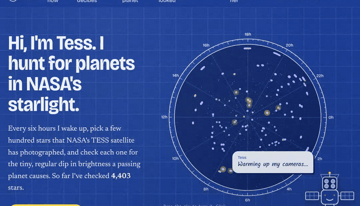
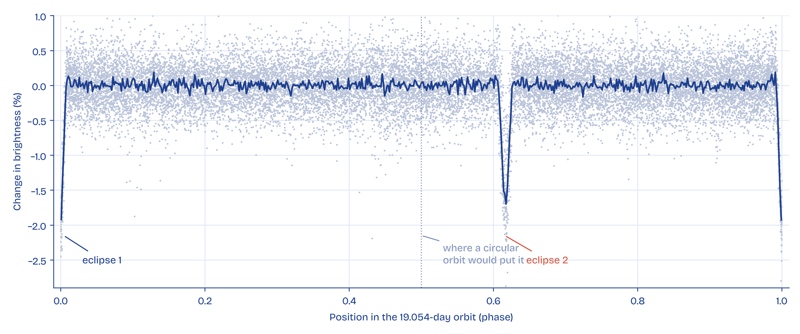
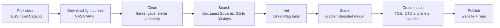
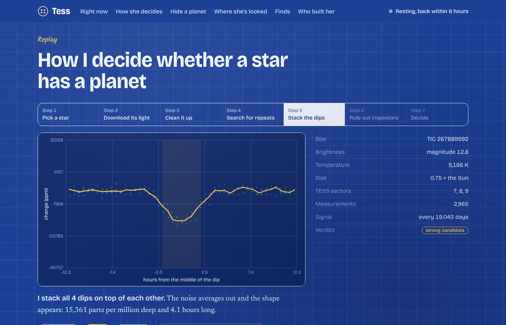
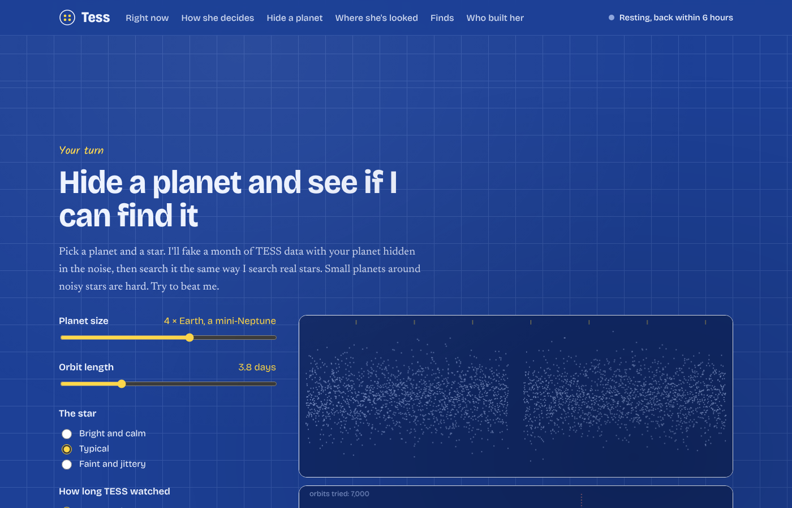

# Tess: an autonomous planet hunter for NASA TESS data

[](https://github.com/alexvaldex/nasa-tess-planet-search/actions/workflows/hunt.yml)
[](https://github.com/alexvaldex/nasa-tess-planet-search/actions/workflows/tests.yml)


Tess is a bot that wakes up every few hours, picks hundreds of stars that NASA's TESS satellite photographed, and searches each one for the tiny, regular dip in brightness a passing planet causes. Every signal goes through the same red-flag tests astronomers use, gets scored by a machine-learning model, and is checked against every public catalog to see whether it is already known. It runs on its own, for free, on GitHub Actions.

**[Watch Tess work](https://alexvaldex.github.io/nasa-tess-planet-search/)** · [Every signal, as a table](https://alexvaldex.github.io/nasa-tess-planet-search/results.html) · [Raw bot logs](https://github.com/alexvaldex/nasa-tess-planet-search/actions/workflows/hunt.yml)



## At a glance

Figures as of October 13, 2026. The live site always has the current numbers.

| | |
|---|---|
| Stars screened | **5,000+** |
| Brightness measurements searched | **25+ million** |
| Confirmed TESS planets found blind (validation) | **241 of 281 (86%)** |
| Proven false positives rejected (validation) | **70%**, while keeping 78% of real planets |
| Open planet candidates | **3** (all small, still being checked) |
| Look-alikes exposed by the deep dive | **5 eclipsing binaries**, including the two strongest early "candidates" |
| Running cost | **$0** |

## What the first 5,000 stars turned up

Tess's first two "strong candidates" were not planets. A deep dive that pulls every sector TESS ever took of a star (up to six years of data) showed that both are **eclipsing binaries**: pairs of stars that take turns blocking each other.

| Star | What Tess first saw | What the full data showed |
|---|---|---|
| TIC 267889592 (Carina, ~925 ly) | A clean 1.5% dip every 19.054 days, 13 times over six years | A *second*, equally deep eclipse at phase 0.62: two similar stars on an oval orbit |
| TIC 415954197 (Pegasus, ~1,800 ly) | A 1.2% dip every 7.140 days | A 3.2% eclipse exactly half an orbit away, also seen in 2022 data |

Each one exposed a hole in Tess's vetting, and both holes are now fixed:

- The secondary-eclipse test relied on a library value that came back with a zero error, which silently hid a 54-sigma second eclipse. Tess now measures it directly.
- The test only looked halfway round the orbit, so eccentric binaries slipped past. Tess now searches the whole orbit (zero of 16 simulated planets wrongly flagged).

As far as Tess can tell, neither binary is listed in VSX, the Gaia DR3 eclipsing-binary catalog, SIMBAD or the TESS eclipsing-binary catalog. The evidence is in [`results/reports/`](results/reports/) and [`results/followup.json`](results/followup.json), and both case files are written up in the printable [field file (PDF)](docs/media/tess-field-file.pdf).

**Still open:** TIC 374098817 (a possible 2.8 Earth-radius planet on a 20-hour orbit, holding up across three observing seasons), TIC 233729835 and TIC 230202008. All three are faint signals and need more data before anyone calls them planets.



## How it works



1. **Pick.** Random sky fields away from the crowded Milky Way plane. Sun-like and red-dwarf stars, TESS magnitude 9 to 13, little light from neighbours, never screened before.
2. **Download.** SPOC, TESS-SPOC and QLP light curves from NASA's MAST archive, using the longest run of consecutive sectors.
3. **Clean.** Drop flares, lone bad points and data next to gaps, then divide out the star's own variability with a robust running median.
4. **Search.** Box Least Squares over every orbit from 0.5 to 30 days, iterated to catch multi-planet systems, with automatic correction when it locks onto half the true period.
5. **Vet.** The tests below.
6. **Score.** A gradient-boosted decision-tree model, trained on about 2,850 simulated light curves plus 338 real TESS planets and false positives, gives each signal a 0 to 1 planet score.
7. **Cross-match.** By star ID and by sky position (within two TESS pixels, at the same period or a harmonic) against every public catalog. A fresh catalog download is checked again after every run.
8. **Publish.** Diagnostic plots, a replay file per star and the results tables are committed back to this repo and served on the website.

### Vetting tests

| Test | What it catches |
|---|---|
| Strength (SDE ≥ 9, SNR ≥ 7) | Noise that happens to line up |
| At least 3 transits | Coincidences |
| Single-event dominance | One glitch or momentum dump faking a periodic signal |
| Robust in-transit depth | A handful of bad points creating the dip |
| Odd vs. even depth | Eclipsing binaries found at half their period |
| Second eclipse anywhere in the orbit | A glowing companion star, including on oval orbits |
| Every TESS sector (deep dive) | Signals that fade, shift or reveal a second eclipse with more data |
| Transit shape | V-shaped grazing binaries |
| Implied size | Anything far bigger than Jupiter |
| Duration vs. stellar density | Signals too short or long for the star |
| Centroid shift | The dip happening on a neighbouring star |
| Dip-to-dip consistency | Blends and artefacts that change from orbit to orbit |
| Out-of-transit wave | Pulsating stars, spotted stars and contact binaries |
| Shared period across stars | Spacecraft systematics seen in many unrelated stars at once |

## Validation

- **Blind recovery.** The search was run on stars with confirmed TESS planets without being told where the planets were. It recovered **241 of 281 (86%)**. Misses are mostly very shallow or long-period planets.
- **Hard false positives.** On TESS signals that passed NASA's own first cut but were later proven not to be planets, the full vetting stage rejects **70%** while keeping **78%** of real planets (5-fold cross-validated, so the model is never graded on stars it trained on).
- **Model alone.** Cross-validated ROC AUC of the planet score is 0.98 overall and 0.86 on real TESS objects alone.

Details: [`results/validation.json`](results/validation.json), [`models/metrics.json`](models/metrics.json), [`results/verify.json`](results/verify.json).

## The website

The [site](https://alexvaldex.github.io/nasa-tess-planet-search/) is written in Tess's voice and built for a symposium booth as much as a browser.

- **Sky dome.** Tess, a line-drawn version of the TESS satellite, points her cameras at each real star she has checked and gives her verdict. Drag the sky to turn it, click any star, or look one up by TIC number.
- **Live diary.** What the current run is doing, updated every 15 minutes while it works.
- **Replay.** A seven-step animation of exactly how one star was judged, using its real data.
- **Hide a planet.** Visitors choose a planet and a star; Tess fakes TESS data with it hidden in the noise and searches it live in the browser.
- **Booth mode.** Add `?kiosk=1` for a full-screen auto-playing replay.

| | |
|---|---|
|  |  |

## Run it yourself

```bash
pip install -r requirements.txt
python -m tph demo                 # offline: hide a planet in simulated data and find it
python -m tph hunt --n 50          # screen 50 real TESS stars
python -m tph verify               # re-check candidates against fresh catalogs
python -m tph report 374098817     # deep dive: every TESS sector, distance, catalogs
python -m tph followup             # apply deep-dive verdicts
python -m tph train-real --n 100   # validate on known planets and retrain the model
python -m tph dashboard            # rebuild the website data
pytest -q                          # offline test suite
```

## Bot controls (Actions tab)

| Workflow | Trigger | What it does |
|---|---|---|
| Hunt for planets | every 6 hours, and each run queues the next | Screens up to 800 new stars, verifies candidates, commits results |
| Verify candidates | manual, and after every hunt | Re-checks candidates against freshly downloaded catalogs |
| Candidate deep dive | manual | Every TESS sector, Gaia, variable-star catalogs and neighbours for chosen stars |
| Retrain everything | manual | Regenerates simulations, validates on real TESS objects, retrains the model |
| Tests | every push | Offline test suite |

To pause Tess, disable "Hunt for planets" in the Actions tab.

## Limitations

- Candidates are unconfirmed and need follow-up observations.
- QLP light curves have no centroid data, so the centroid test only applies to SPOC and TESS-SPOC stars (about 60%).
- Planet sizes depend on stellar radii from the TESS Input Catalog.
- The model has seen a few hundred real labelled examples; more real training data would sharpen it.
- A large share of raw detections are spacecraft systematics. They are filtered out, but the filter is conservative and can hide a real signal that happens to share a period with others in the same sectors.

## Project layout

```
tph/
  catalogs.py     target selection; TOI / CTOI / planet / eclipsing-binary cross-matching
  fetch.py        MAST light curves and centroids via lightkurve
  detrend.py      cleaning, binning, gap trimming, variability removal
  search.py       Box Least Squares with period-doubling correction
  vet.py          physical vetting tests
  model.py        planet-score model: training, cross-validation, scoring
  postprocess.py  population-level checks (shared-period veto) and re-vetting
  simulate.py     realistic synthetic TESS light curves for training
  replay.py       per-star step-by-step records for the website
  plots.py        diagnostic sheets
  pipeline.py     per-star processing
  dashboard.py    website data and results summary
docs/             the website (GitHub Pages), candidate plots, replay files
results/          screened.csv, candidates.csv, validation.json, verify.json
models/           trained model and metrics
```

## Data and credits

- TESS light curves from NASA's Mikulski Archive for Space Telescopes: SPOC (Jenkins et al. 2016), TESS-SPOC (Caldwell et al. 2020), QLP (Huang et al. 2020)
- TESS Input Catalog (Stassun et al. 2019), ExoFOP-TESS TOI and CTOI lists, NASA Exoplanet Archive
- TESS eclipsing binary catalog (Prša et al. 2022, ApJS 258, 16)
- Box Least Squares (Kovács, Zucker & Mazeh 2002)
- Built with lightkurve, astropy, astroquery and scikit-learn

If you use this work, see [`CITATION.cff`](CITATION.cff).

Built by **Alejandro Valdez**, Aerospace Engineering, University of Central Florida. [LinkedIn](https://www.linkedin.com/in/alejandro-valdez15)
