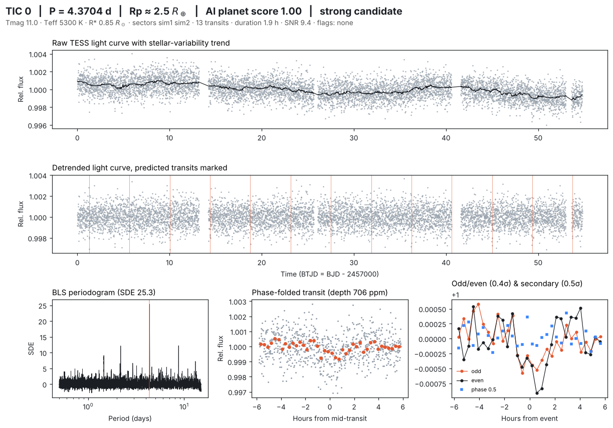

# NASA TESS Planet Search

**An autonomous bot that searches NASA TESS data for undiscovered exoplanets.**

NASA's Transiting Exoplanet Survey Satellite (TESS) has photographed almost the entire sky since 2018, producing brightness measurements for millions of stars. NASA's own pipeline focuses on a small set of priority targets, so most of those light curves have never been searched closely. This project searches them automatically.

Every 6 hours a GitHub Actions bot:

1. **Selects** a fresh batch of stars from the TESS Input Catalog (sun-like and M dwarfs, magnitude 9 to 13, low contamination from neighbours, away from the crowded galactic plane)
2. **Downloads** their light curves from NASA's MAST archive (SPOC, TESS-SPOC and QLP products)
3. **Cleans** them: removes flares and bad data, divides out stellar variability with a robust running median
4. **Searches** for periodic transits with Box Least Squares (0.5 to 15 day periods), iteratively, to catch multi-planet systems
5. **Vets** every signal with the physical tests astronomers use: odd/even depth, secondary eclipse, transit shape, implied radius, duration vs. stellar density, single-event dominance
6. **Scores** it with a machine-learning vetter (gradient-boosted trees) trained to separate planets from eclipsing binaries, blended binaries and systematics
7. **Cross-matches** against every TESS Object of Interest, confirmed planet, and the TESS eclipsing binary catalog to isolate what is genuinely new
8. **Publishes** diagnostic plots and a ranked candidate list to the results dashboard, and commits everything to this repo

**Results dashboard:** see the GitHub Pages site for this repo (`docs/`), or [`results/SUMMARY.md`](results/SUMMARY.md).

## The website

`docs/index.html` is Tess's public site (GitHub Pages). Tess, a line-drawn version of the TESS satellite, sweeps a sky dome pointing at every real star the bot has checked and says its verdict; visitors can drag the sky and click any star to ask about it. Below that: a live diary of the current run, an animated replay of how each star is judged, an all-sky coverage map, finds, and an FAQ. `docs/results.html` is the full table of every signal. The bot regenerates `data.json`, `sky.json`, `status.json` and `stars/*.json`; the page itself is hand-built and never overwritten.

The replay section works as Mission Control:

- **Replay theater** walks through each star step by step: pick → download → clean → search → fold → check → verdict, with animated plots and a plain-English caption for every step. Built for a booth screen: add `?kiosk=1` for full-screen auto-play of candidates.
- **All-sky map** of every star searched, colour-coded by verdict, with the Milky Way plane (skipped: too crowded) marked.
- **Live feed** of the current run, refreshed from `docs/status.json`, which the bot pushes every ~15 minutes while it works. The raw log is linked from the page (GitHub Actions tab).

## How do we know this isn't already-searched data?

Honest answer: the *pixels* are not untouched. NASA's SPOC and MIT's QLP pipelines run automated transit searches on these light curves, and citizen-science projects look too. What matters is whether a **signal** is already known. Three layers handle that:

1. **The bot never repeats itself.** Every star it screens goes into `results/screened.csv` and is excluded from future runs.
2. **Every detection is cross-matched against every public TESS catalog:** all TESS Objects of Interest (NASA's official candidate list), Community TOIs (independent and citizen-science finds), the NASA Exoplanet Archive's confirmed planets, and the TESS eclipsing binary catalog. Matches are by star ID *and* by sky position (within 2 TESS pixels, catching light leaking from a known neighbour), at the same period or a harmonic.
3. **Only what survives is called "new".** A new candidate is a signal no public catalog lists. These exist because official pipelines use fixed thresholds, mostly single-sector searches, and limited human vetting time for faint stars, so real shallow or multi-sector signals slip through.

Before claiming a find publicly, also check the star on ExoFOP (linked for every candidate) and search the literature.

## Example diagnostic

Each candidate gets a one-page vetting sheet: raw and detrended light curve, BLS periodogram, phase-folded transit, odd/even comparison and secondary-eclipse check.



## Validation

Two independent checks keep the results honest:

- **Injection-recovery on simulations.** Thousands of realistic synthetic light curves (limb-darkened planet transits, eclipsing binaries, diluted background binaries, instrumental systematics, red noise, stellar rotation, data gaps) are run through the exact same pipeline. Metrics: [`models/metrics.json`](models/metrics.json).
- **Blind recovery of real planets.** The `train-real` workflow runs the blind search on confirmed TESS planets and known false positives, reports the fraction of real planets it recovers, and retrains the vetter on real data. Results: [`results/validation.json`](results/validation.json).

## Important caveat

Everything this finds is a **candidate**, not a confirmed planet. Confirmation needs follow-up: ground-based photometry to rule out nearby eclipsing binaries, spectroscopy for mass, high-resolution imaging. Strong candidates can be submitted to [ExoFOP-TESS](https://exofop.ipac.caltech.edu/tess/) as Community TOIs (CTOIs).

## Cost

Zero. GitHub Actions minutes are free and unlimited on public repositories. Each run screens up to ~400 stars in a ~4.5 hour budget, four runs a day.

## Run it yourself

```bash
pip install -r requirements.txt
python -m tph demo                 # offline: hide a planet in simulated data and find it
python -m tph hunt --n 50          # screen 50 real TESS stars
python -m tph train-real --n 100   # validate on known planets, retrain the vetter
python -m tph dashboard            # rebuild docs/index.html
pytest -q                          # offline tests
```

## Bot controls (Actions tab)

| Workflow | Trigger | What it does |
|---|---|---|
| Hunt for planets | every 6 h, or manual | screens new stars, commits results |
| Train vetter on real TESS planets | manual | blind-recovery validation + retrain on real TOIs |
| Train vetter on simulations | manual | regenerate synthetic training set + retrain |
| Tests | every push | offline test suite |

GitHub pauses scheduled workflows after 60 days with no repository activity. If that happens, re-enable "Hunt for planets" from the Actions tab.

## Project layout

```
tph/
  catalogs.py   TIC target selection; TOI / confirmed planet / TESS EB cross-matching
  fetch.py      MAST light curve download via lightkurve
  detrend.py    cleaning, binning, variability removal
  search.py     Box Least Squares transit search with period-doubling correction
  vet.py        physical vetting diagnostics
  model.py      ML vetter: training, cross-validation, scoring
  simulate.py   realistic synthetic TESS light curves
  plots.py      diagnostic sheets
  pipeline.py   per-star processing
  dashboard.py  public results site
results/        screened.csv, candidates.csv, validation.json, SUMMARY.md
docs/           GitHub Pages dashboard + candidate plots
models/         trained vetter + metrics
```

## Data & references

- TESS light curves: NASA MAST (SPOC: Jenkins et al. 2016; TESS-SPOC: Caldwell et al. 2020; QLP: Huang et al. 2020)
- TESS Input Catalog: Stassun et al. 2019
- TOI catalog: ExoFOP-TESS; confirmed planets: NASA Exoplanet Archive
- TESS eclipsing binaries: Prša et al. 2022, ApJS 258, 16
- Box Least Squares: Kovács, Zucker & Mazeh 2002
- Tools: lightkurve, astropy, astroquery, scikit-learn

Built by Alejandro Valdez, Aerospace Engineering, University of Central Florida.
